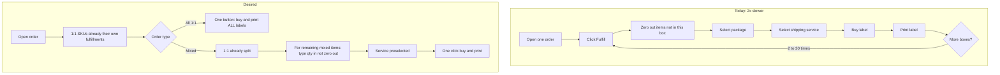

# Petals Shopify fulfillment efficiency investigation

Source task: [Optimize Fulfillment Process](https://whirlwind.teamwork.com/app/tasks/41004350) (Teamwork `#41004350`, due 2026-08-27).

Scope is **native Shopify Admin first**, then **off-the-shelf shipping/fulfillment apps**. A custom Shopify app is out of scope (PM meant Admin features, not something we build). This theme repo only has storefront + [scripts/shipping-packages/](scripts/shipping-packages/) (saved box per SKU); it is not a warehouse app.

## What we already know from live Admin (2026-08-24)

Shopify Plus, org OFFICESCAPES LLC dba Petals. Inspected in Chrome (this staff login cannot update **Shopify CLI Connector App**, so no CLI GraphQL).

**Shipping setup** ([Settings → Shipping and delivery](https://admin.shopify.com/store/petalscom/settings/shipping)):

- Own **UPS 6A215X** and **FedEx** accounts connected (labels buyable in Admin on those contracts).
- Shopify Shipping preferred UPS services: **6 of 14** on (Ground, Ground Saver, 2nd Day Air, Next Day Air, Next Day Air Saver, Next Day Air Early).
- **79 boxes + 1 envelope**. Variant package assignment is working at print time (`Petals Package #N` on live labels).
- No custom fulfillment service, no delivery customizations.

**Orders → Shipping labels** is already daily ([shipping_labels](https://admin.shopify.com/store/petalscom/shipping_labels)):

- **250 orders to ship**.
- UPS tracking `1Z6A215X…` = own UPS account, not a generic Shopify shipper.
- **FedEx Home Delivery** on the same page today (e.g. #320836).
- Warehouse already splits by hand: `#320387-F4`, `#320355-F7`. That split-and-label loop is the 2x cost.
- Mix of **1 item / 1 package** rows and **Multiple items** in one package.

**Volume:** ~3,923 orders / last 30 days; today ~78 orders, 100 fulfilled, median 86 hours order→fulfill.

**Installed apps:** Order Printer, Matrixify, Klaviyo, TaxJar, Judge.me, Checkout Blocks, Minmaxify, Kite, Data Feed Watch, Draftable, Search & Discovery, Clarity, GiftCard Import, Spectrum Data Access, Shopify CLI Connector. **No ShipStation / Shippo / EasyPost / Veeqo.**

## Native Admin vs cannot (task phase 1)

| Bottleneck | Native Admin | Off-the-shelf app |
|---|---|---|
| **1. Fulfill UI defaults remaining qty to ALL** (must zero out) | **Cannot change.** No setting to start qty at 0. | Packing UIs are usually scan-to-add or start at 0. |
| **2. Auto-split 1:1 SKUs into their own fulfillments** | **Cannot auto-split.** Shopify already suggests the assigned box; humans still split (today: `#order-F1`…`F7`). Flow cannot reliably loop “qty 12 → 12 shipments of 1.” | Apps with product rules / auto-split (ShipStation auto-split, Shippo, etc.) are the path. Identify 1:1 from Admin sampling (SKU always alone vs appears on “Multiple items”), then tag/metafield if package assignment is not enough. |
| **3. One button: buy + print ALL labels on a 1:1 order** | **Partial, already used.** [Shipping labels](https://admin.shopify.com/store/petalscom/shipping_labels) is bulk buy/print across orders (up to 250), still **buy then print**, not one click on a 30-box order. If 1:1 were pre-split, warehouse could stay on this page instead of the per-order fulfill loop. | Strongest fit: batch create + print all packages on one order, own UPS + FedEx accounts. |
| **4. Pre-select a specific shipping service** | Native **can** prefer services (6 UPS services already on). It **cannot** lock one service with zero clicks. Live labels mix Ground, 2nd Day, and FedEx Home Delivery — **do not collapse the list until Admin sampling shows the rule.** | Apps can default a service **or** rate-shop / apply rules (match checkout method, cheapest, residential FedEx, etc.). |
| **5. One-step buy and print** | **Cannot.** Native is buy, then print. | Most shipping apps combine purchase + thermal print. |
| **6. 3–10s per label purchase** | **Cannot remove** sequential carrier round-trips in Admin. | Batch/cached rates; parallel buys. Must support own UPS `6A215X` + FedEx. |

Shopify Flow is native-ish but is **not** a fit for “split every 1:1 unit into its own fulfillment” at this volume. Treat Flow as out unless an app ships a Flow action.

## Infer from Admin first (do not ask PM until we have a pattern)

Most of both questions can be **read off orders + fulfillments + the Shipping labels page**. Ask PM only to confirm the pattern (or explain leftovers). A blank A–E quiz is weaker than “12 of 15 2nd Day labels sat on Express checkout — is that the rule?”

### Service mix — what to open

For each sampled label, pair **what was bought** with **what the order asked for**:

| Look at | Where | What it tells you |
|---|---|---|
| Label service | Shipping labels row | UPS Ground / 2nd Day / FedEx Home Delivery |
| Checkout shipping | Order → shipping method / paid rate name | Did they **match the customer** (A)? |
| Address | Order shipping address (residential vs company, ZIP) | FedEx Home Delivery vs UPS Ground (C) |
| Weight / package | Label package + lb | Ground Saver vs Ground vs 2nd Day by size (E) |
| Label $ vs checkout shipping $ | Label cost vs order shipping charge | Weak signal for rate-shop (B); Admin does not show the other rates they skipped |

**How to sample:** ~15 Ground + every 2nd Day + every FedEx on the current Shipping labels page (and a couple of `#order-Fn` splits). Open each linked order.

**What sampling cannot prove:** a one-off (UPS down, warehouse habit that day). If 80%+ of 2nd Day labels sit on Express checkouts, treat that as the rule and ask PM to confirm, not to invent the rule from scratch.

### 1:1 vs “Multiple items” — what to open

| Look at | Where | What it tells you |
|---|---|---|
| Items on the label | Shipping labels: `1` + product title vs `2` + “Multiple items” | Combined box vs single SKU |
| Same SKU, qty &gt; 1 | Order line qty vs how many F1/F2/F3 labels | If qty 3 → three qty-1 labels with the same package, that SKU is operationally 1:1 |
| SKUs inside a Multiple-items fulfillment | Order fulfillments / packing slip | Those SKUs are combinable (the ~20% mixed path) |
| Assigned package on the product | Product/variant shipping package | If a SKU with Package #N also appears on Multiple-items labels, **package assignment ≠ 1:1** (question 3) |

**How to sample:** 10 one-item labels, 5 `#order-Fn` splits of the same parent order, 5 “Multiple items” labels. List SKUs that only ever appear alone vs SKUs that get combined.

**What sampling cannot prove:** whether a combined box was a packing error vs policy. If the same SKU pair is combined on several days, treat it as policy.

**Customer emails:** Timeline on a split order shows whether Shopify sent one notification per fulfillment. Intent (want that or not) still needs a human.

### Short PM confirm (only after sampling)

“We sampled N labels. 2nd Day tracked with Express checkout in X/Y cases. FedEx Home Delivery was residential in X/Y. SKUs A,B,C always split to one label per unit; SKUs D,E show up on Multiple-items packs. Does that match how you want apps to behave?”

## What we will produce next

1. Admin sample of service mix + 1:1 vs Multiple-items (table above), then a **short confirm** to PM if the pattern is noisy.
2. Native vs cannot writeup for the Teamwork task.
3. Optional timing: per-order fulfill loop vs staying on Shipping labels (no preferred-service changes until the mix rule is clear).
3. **Vendor RFP** (run the email by you first), scored to the six bottlenecks **plus**:
   - Own UPS account `6A215X` + FedEx in the same UI
   - Auto-split 1:1 SKUs (one shipment per unit) using tag/metafield/package
   - Mixed remainder: qty starts at 0 or scan-to-add, not “zero out the rest”
   - Batch buy + print all packages on one order; thermal printers
   - Default service **or** rules from PM answer (Ground vs 2nd Day vs FedEx)
   - One-step buy and print; faster than 3–10s sequential Admin buys

Candidate list (not exhaustive): ShipStation, Shippo, EasyPost (or EasyPost-powered Shopify apps), Veeqo, PluginHive Multi Carrier, ShippingEasy, Easyship, Pirate Ship, Ordoro, ShipHero, Linnworks, Packlink, Sendcloud, AfterShip Shipping, plus 2–3 scan-to-pack WMS apps if mixed qty-entry is the gap.

## Out of scope

- Building a custom Shopify app or Admin UI extension.
- Changing the theme.
- Installing a shipping app on production or sending vendor emails until you approve the draft.
- Collapsing the 6 preferred UPS services until sampling (and PM confirm if needed) shows a single default is safe.
